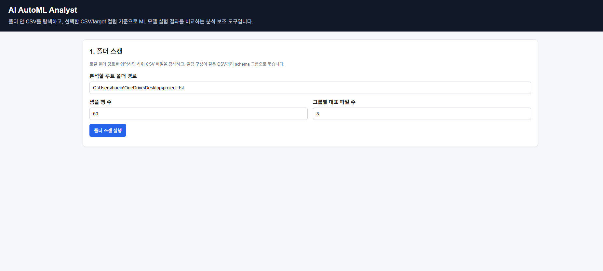
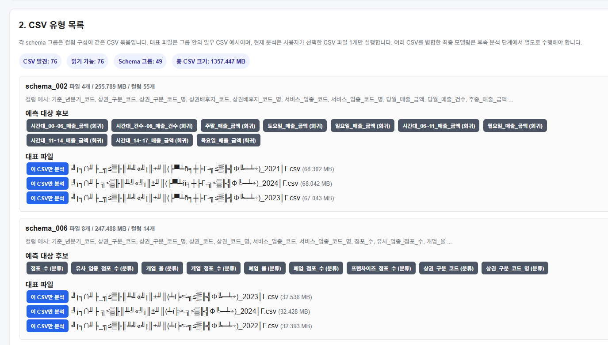
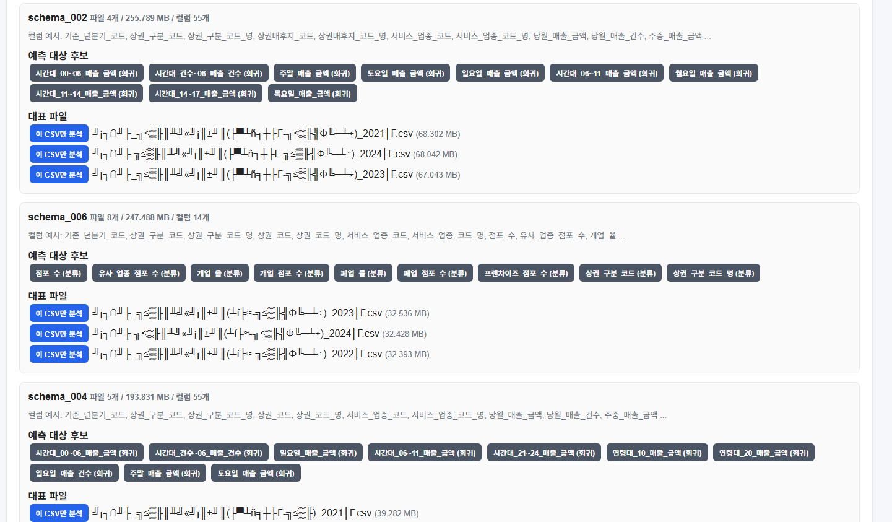
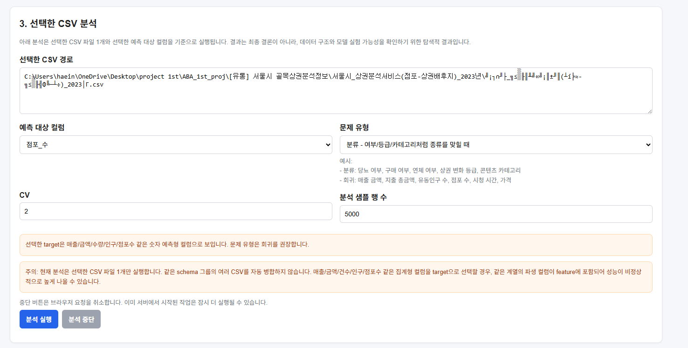
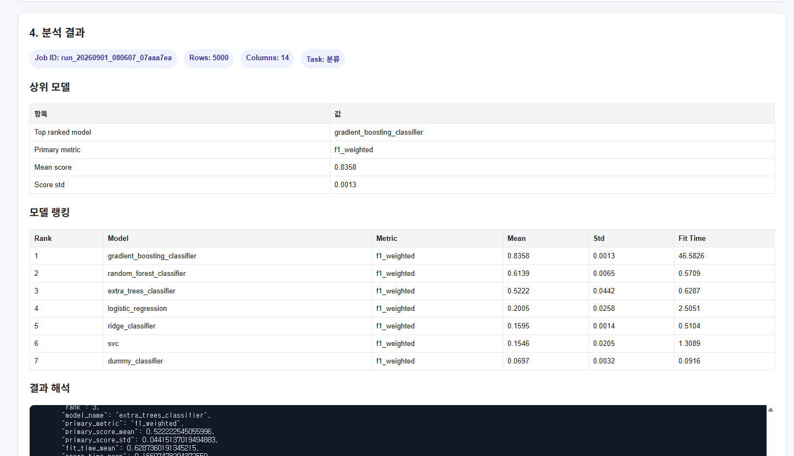
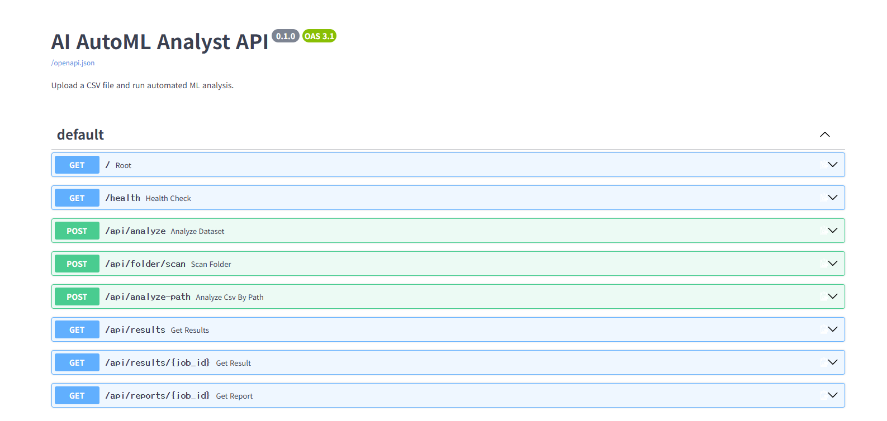

\# AI AutoML Analyst


AI AutoML Analyst는 사용자가 승인한 CSV/XLSX 파일 하나를 로컬에서 진단하고 보고서로 제공하는 FastAPI 기반 분석 도구입니다. 현재 BASIC, STANDARD, PREMIUM 로컬 MVP를 개발 중이며 세 상품 모두 판매 승인은 보류 상태입니다.


분석은 고객 파일을 외부 서비스로 전송하지 않습니다. 폴더 탐색 및 임의 경로를 읽는 레거시 API는 비활성화되어 있으며, 각 상품 페이지에서 파일을 직접 선택해 업로드합니다.


\---


\## 주요 기능


\- BASIC: 데이터 품질·기초 통계·적합성 진단과 PDF/ZIP 보고서 (모델 학습 없음)

\- STANDARD: 사용자 확인 대상에 대한 분류/회귀, Dummy 기준선, 교차검증 및 독립 홀드아웃

\- PREMIUM: 최대 5개 비-Dummy 후보 비교, 신뢰된 로컬 모델 산출물과 동일 스키마 CSV 재예측

\- CSV/XLSX 업로드, 한국어 PDF, 분석표·차트와 무결성 확인된 상품별 ZIP

\- 기본 실행은 localhost 전용이며 외부 공개 서버로 사용할 수 없음


\---


\## 기술 스택


\- Python

\- pandas

\- scikit-learn

\- FastAPI

\- Uvicorn

\- HTML / CSS / JavaScript

\- Git


\---


\## 프로젝트 구조


```text

AI\_AutoML\_Analyst/

├─ backend/

│  └─ app/

│     ├─ main.py

│     ├─ models/

│     │  └─ registry.py

│     └─ services/

│        ├─ profiler.py

│        ├─ task\_detector.py

│        ├─ preprocessor.py

│        ├─ evaluator.py

│        ├─ trainer.py

│        ├─ ranker.py

│        ├─ automl\_runner.py

│        ├─ model\_selector.py

│        ├─ folder\_scanner.py

│        ├─ ai\_analyst.py

│        ├─ recommendation.py

│        ├─ report\_generator.py

│        └─ storage.py

├─ frontend/

│  └─ index.html

├─ data/

├─ experiments/

├─ tests/

├─ pyproject.toml

├─ .gitignore

└─ README.md
```


---

## 현재 한계

- 현재 분석은 선택한 CSV 파일 1개 기준으로 실행됩니다.
- 같은 schema group의 여러 CSV를 자동 병합하지는 않습니다.
- JSON, ZIP, SHP 등 비정형/공간 데이터는 분석 대상이 아닙니다.
- 허용 크기·행·열 한도를 넘는 파일은 샘플링으로 숨기지 않고 거부합니다.
- target 후보는 자동 확정이 아니라 사용자가 선택하기 위한 참고 정보입니다.
- 고객 데이터의 권한·비식별화와 실제 업무에 맞는 target/split 선택은 고객 및 분석 담당자가 확인해야 합니다.
- 성능 보장이나 인과관계 주장을 하지 않습니다. 부적합한 데이터에서는 정직한 no-skill/no-prediction 결과를 제공합니다.

---

## 판매 승인 전 직접 확인 항목

- BASIC, STANDARD, PREMIUM 각각의 PDF/ZIP 시각 품질
- 각 결과에 실제 사용된 폰트와 프로그램·의존성 소스 라이선스
- 상품별 명시적 상업적 판매 GO

멀티파일 조인, 백그라운드 취소, React, PostgreSQL, 공개 SaaS는 이 로컬 MVP 범위가 아닙니다.

---

## 실행 요약

### 로컬 실행

```powershell
python -m venv .venv
.\.venv\Scripts\activate
python -m pip install -r requirements-verified-py311.txt
python -m uvicorn backend.app.main:app --host 127.0.0.1 --port 8000
```

브라우저:

```text
http://127.0.0.1:8000/basic-mvp
http://127.0.0.1:8000/standard-mvp
http://127.0.0.1:8000/premium-mvp
http://127.0.0.1:8000/docs
```

---

### Docker 실행

```powershell
docker compose up --build
```

브라우저:

```text
http://127.0.0.1:8000/basic-mvp
```

Compose는 호스트의 `127.0.0.1:8000`에만 포트를 게시합니다. 임의 데이터 경로 마운트와 레거시 폴더 스캔은 지원하지 않습니다. Docker PDF 생성을 위해 권리를 확인한 `NanumGothic.ttf`를 프로젝트의 Git 무시 폴더 `local-fonts/`에 두세요. 일본어 글리프가 필요하면 권리와 TTF 임베딩 허용을 확인한 `Japanese.ttf`도 둘 수 있습니다. 이 폴더는 컨테이너에 읽기 전용으로 마운트되며 이미지나 Git/ZIP에 포함되지 않습니다. `0.0.0.0` 또는 와일드카드 호스트 포트로 외부 공개하지 마세요. 컨테이너 내부 Uvicorn은 Docker 네트워크 연결을 위해 `0.0.0.0`에서 수신합니다.

---

## Repository

```text
https://github.com/hibi89/AI_AutoML_Analyst
```

---

## 화면 예시

### 1. 프론트 첫 화면



### 2. 폴더 스캔 결과



### 3. CSV 유형 목록



### 4. 분석 설정 화면



### 5. 분석 결과



### 6. Swagger 또는 Docker 실행 화면


